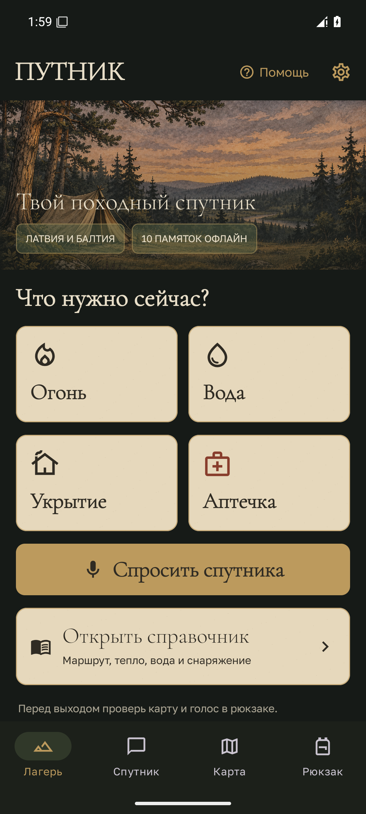
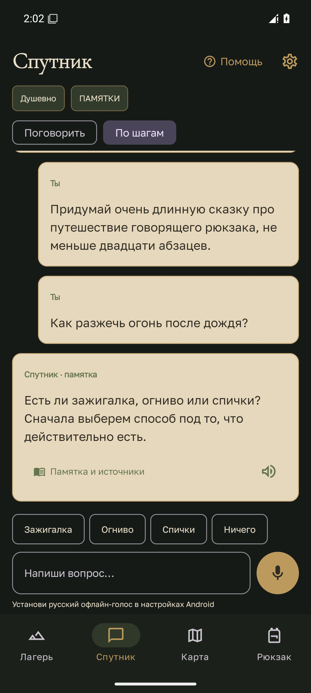
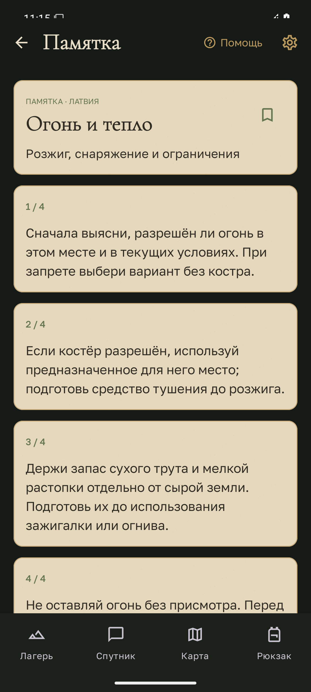
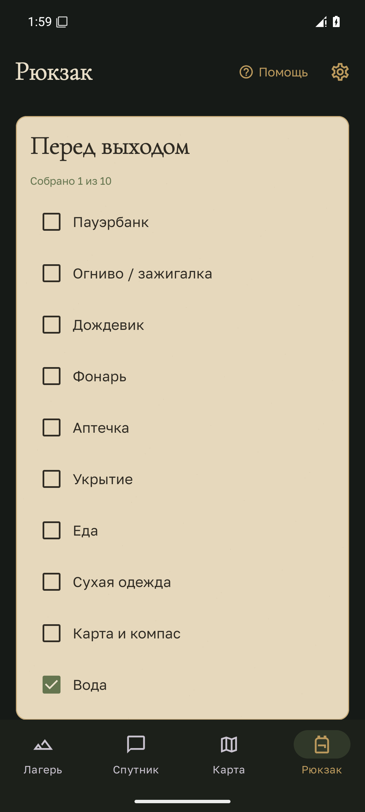
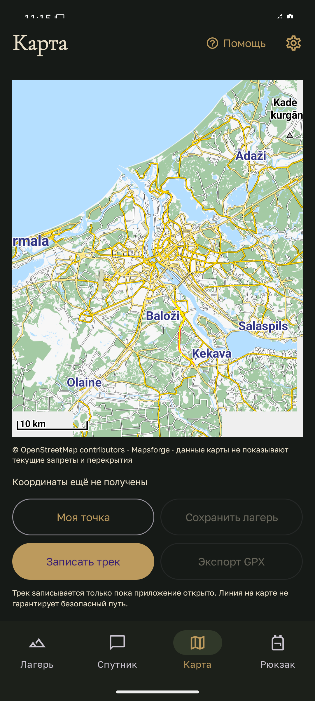
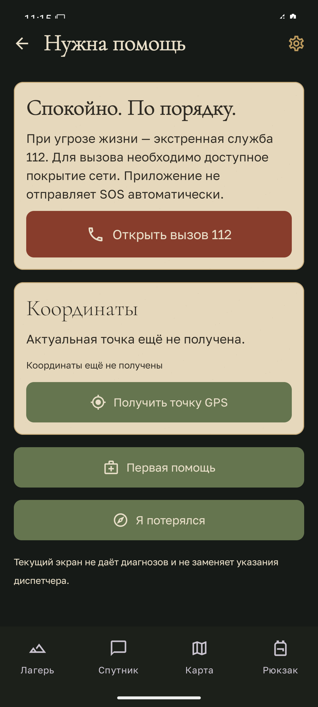

# Путник · Survival Kit

Русский Android-спутник для походов в Латвии: свободный разговор с локальным AI, офлайн-памятки, голос, карта и снаряжение. Визуальное направление — походный дневник: лес, кожа, латунь и пергамент.

**Первая alpha, не завершённый полевой продукт.** Состояние Android-сборки и UI-проверок видно в [Actions](https://github.com/Kurubik/survival-kit/actions/workflows/android.yml). APK публикуется в [pre-releases](https://github.com/Kurubik/survival-kit/releases) только после успешной сборки, unit-тестов, lint и Android emulator UI-тестов. Эмулятор не заменяет проверку на реальном телефоне.

## Скриншоты

Реальные экраны [alpha-12](https://github.com/Kurubik/survival-kit/releases/tag/alpha-12): Android 35, эмулятор Pixel 6, 1080 × 2400. Это снимки приложения, не AI-макеты. На экране спутника показан сценарный режим без загруженной AI-модели; карта Латвии открыта из локального пакета с отключёнными Wi-Fi и мобильными данными.

| Лагерь | Спутник | Памятка |
| :---: | :---: | :---: |
|  |  |  |

| Рюкзак | Офлайн-карта | Помощь |
| :---: | :---: | :---: |
|  |  |  |

[Оригинальные PNG](docs/screenshots/) · [Прогон сборки и Android-проверок](https://github.com/Kurubik/survival-kit/actions/runs/44071562775). Исходный код этих экранов: [`1581149`](https://github.com/Kurubik/survival-kit/commit/1581149178088301e929615ff4dc0dcf697e726f).

## Реализовано в исходниках

- Нативный Kotlin + Jetpack Compose, русский интерфейс и включённые в APK кириллические шрифты.
- Десять кратких офлайн-карточек: огонь, вода, укрытие, холод, ориентирование, клещи, первая помощь, рюкзак, болота и погода. Карточки редакционные, без завершённой профессиональной медицинской проверки.
- Два отдельных режима: **«Поговорить»** для свободного разговора с локальной моделью и **«По шагам»** для автономных памяток. Можно обсуждать обычные темы, а не только содержание справочника.
- Локальный поиск, уточнение снаряжения и команды «дальше», «повтори», «назад», «стоп» в режиме памяток; ссылки на источники, закладки и история диалога.
- Русская озвучка через установленный **офлайн**-голос Android. Если голос не установлен, это явно показано.
- Голосовой ввод Vosk с отдельным RU-пакетом; до его установки — только доступный системный **on-device** recognizer, без автоматического облачного fallback.
- Расшифровка голоса сначала попадает в редактируемое поле: пользователь проверяет отрицания и отправляет вопрос. Непроверенное распознавание не запускает действия автоматически.
- Отдельная офлайн-карта Латвии Mapsforge; GPS-точка, сохранённая стоянка, трек при открытом приложении и GPX-экспорт. Карта не определяет безопасный маршрут и не показывает действующие ограничения.
- Локальные снаряжение, заметки, закладки, светлый полевой режим и экран помощи с открытием системного вызова 112. Никакой имитации отправленного SOS.
- Дополнительный Qwen3 4B GGUF через JNI/llama.cpp: свободный диалог, ограниченный контекст последних реплик, потоковое появление ответа и автоматическое открытие скачанной модели при сообщении. Три профиля общения, включая **Pohuy Ultra**. Экстренные запросы открывают нейтральную карточку без ожидания AI.
- Без модели интерфейс честно предлагает загрузку, а не выдаёт сценарный ответ за живой разговор. История последних 40 сообщений сохраняется на телефоне; в AI передаётся ограниченная недавняя часть именно свободной беседы, отдельно от пошаговых сценариев.
- SHA-256 и точный размер загрузок, ограничения распаковки, отмена загрузки, работа основных карточек без модели.

## Первый запуск

1. Установить APK из завершённого prerelease. Это debug-signed alpha для испытаний, не production-подпись; бесшовные обновления между CI-сборками пока не гарантируются.
2. Уже без интернета и AI доступны карточки, режим «По шагам» и чек-лист.
3. В «Рюкзаке» по желанию скачать русское распознавание (46.2 МБ) и карту Латвии (110.2 МБ). Требуется дополнительное место для распаковки.
4. В настройках Android установить русский офлайн TTS-голос, если его нет; затем проверить чтение вслух в приложении.
5. Для свободного общения скачать Qwen3 4B (2.50 ГБ) в чате или рюкзаке и выбрать «Поговорить». Скачанная модель откроется сама при сообщении. Нужна достаточная свободная RAM; генерацию можно остановить. Поиск в интернете и облачный API не используются: общие знания модели не являются текущей погодой, новостями или проверкой обстановки.
6. Перед реальным выходом проверить функции в авиарежиме. Разрешения микрофона и GPS выдаются только по действию пользователя.

## Что ещё не подтверждено

Качество распознавания при ветре, системные RU-голоса разных телефонов, качество ответов и устойчивость Qwen на устройстве, потребление батареи и полевой GPS. Нет профессионального допуска медицинского корпуса, текущей базы костровых запретов, навигационной маршрутизации и фоновой записи трека. Литва/Эстония пока не поставляются. Большая библиотека книг Lastbook не включена.

После ухода приложения с экрана запись голоса и трека останавливается, AI выгружается. Скачивание рассчитано на открытое приложение; после прерывания можно запустить заново. Аудиозаписи не сохраняются. Не нужны аккаунт и API-ключ.

## Сборка

JDK 21, Android SDK 35, Build Tools 35.0.0, NDK 27.2.12479018, CMake 3.22.1. Gradle wrapper 8.11.1. Нативная сборка ожидает стандартные x86_64 Android build tools; полноценный CI выполняется на Ubuntu x86_64.

```bash
export ANDROID_HOME=/opt/android-sdk
./gradlew :core:test :app:lintDebug :app:assembleDebug
./gradlew :app:connectedDebugAndroidTest
```

Без Android SDK можно проверить переносимый движок:

```bash
SURVIVAL_CORE_ONLY=1 ./gradlew :core:test
```

CI отключает Wi-Fi/data в Android-эмуляторе, открывает реальную карту Латвии и загружает точные веса Qwen3 4B для нативной генерации. Проверяются ответ вне справочника, воспоминание детали предыдущей реплики, потоковый текст, отмена и отклонение устаревшего запроса. `llm-smoke.json` сохраняет настоящие ответы на синтетический диалог. Это ограниченная проверка Android x86_64/JNI, не оценка качества всех тем, человеческой речи, медицинской достоверности или скорости на физическом arm64-телефоне.

## Происхождение и лицензии

[Lastbook](https://github.com/Immortal-Protocols/lastbook) — основа идеи форматов, происхождения рекомендаций и офлайн-библиотеки; см. [UPSTREAM.md](UPSTREAM.md). Python desktop runtime и полная библиотека не переносятся в APK.

Новый код — MIT. Компоненты, модели, шрифты и карта сохраняют отдельные условия: [THIRD_PARTY_NOTICES.md](THIRD_PARTY_NOTICES.md). Правила разработчика: [AGENTS.md](AGENTS.md). Исходный [план](docs/planning/PLAN.md) — архив этапа до реализации; текущие изменения и проверки описаны в [журнале](docs/IMPLEMENTATION.md).
